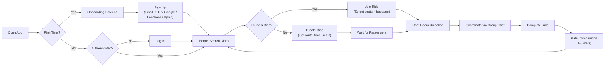
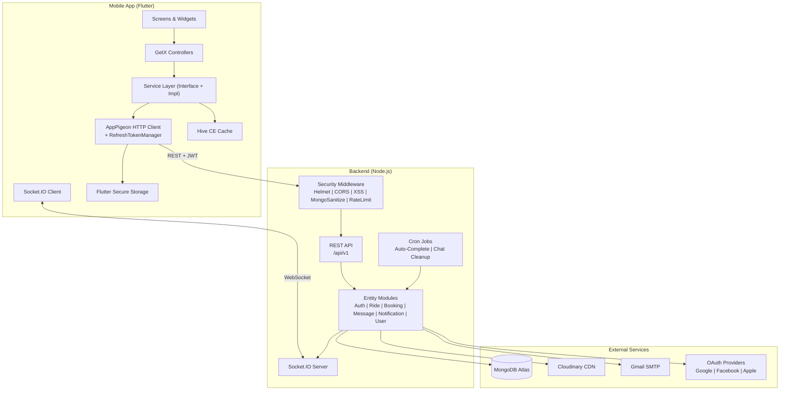

# Hoplift — Business Case Study

> **A Ride-Sharing Platform with Real-Time Coordination, Democratic Governance, and Geospatial Intelligence**

---

**Project:** Hoplift  
**Type:** Full-Stack Mobile Application (iOS + Android)  
**Domain:** Shared Transportation / Carpooling  
**Stack:** Flutter · Node.js · Express · MongoDB · Socket.IO · Cloudinary  
**Status:** Production deployment at `api.hopliftapp.com`  

*`[Screenshot Placeholder: HOP-01 — App home screen with ride search]`*

---

## Executive Summary

Hoplift is a ride-sharing mobile application that connects drivers with available car seats to passengers traveling in the same direction. Unlike traditional ride-hailing services where a professional driver serves a single customer, Hoplift enables peer-to-peer seat sharing — where any user can create a ride, fill remaining seats with others, and share the journey.

The platform addresses three core challenges in shared transportation:

1. **Discovery** — Finding rides that match both origin, destination, departure time, and travel direction using geospatial queries with configurable proximity thresholds.
2. **Coordination** — Managing the lifecycle of a shared ride from creation through completion, including dynamic seat management, real-time group chat (auto-created per ride), and automated ride expiration.
3. **Trust & Safety** — A democratic vote-kick system that allows ride participants to collectively remove disruptive passengers, combined with post-ride mutual ratings and multi-provider identity verification (Google, Facebook, Apple, email+OTP).

The system consists of a Flutter mobile application (supporting 25 languages) and a Node.js backend with real-time WebSocket communication, geospatial database indexing, and scheduled background job processing.

---

## 1. Business Context and Problem Statement

### The Problem

Shared transportation faces a coordination problem that prevents it from being widely adopted:

**For drivers with empty seats:**
- They are already making a trip and have unused capacity (often 2-3 empty seats)
- There is no efficient way to find passengers heading in the same direction at the same time
- Coordinating pickup timing, communication, and trust with strangers creates friction

**For passengers seeking affordable rides:**
- Public transit may not cover their specific route or schedule
- Traditional ride-hailing (Uber, Lyft) serves single-customer trips and is more expensive
- Finding someone driving in the same direction at the right time requires serendipity

**For both parties:**
- There is no standard mechanism to handle conflicts during a shared ride
- There is no way to evaluate ride companions beforehand
- Communication is fragmented across personal messaging apps rather than being tied to the ride context

### Why It Matters

The consequences of poor ride coordination include:
- **Wasted vehicle capacity** — The average car trip carries 1.5 people despite having 4-5 seats
- **Higher transportation costs** — Solo drivers bear the full cost of fuel, tolls, and vehicle wear
- **Communication overhead** — Managing ride logistics through personal messages is disorganized and doesn't expire when the ride ends
- **Trust barriers** — Without ratings and identity verification, users are reluctant to share rides with strangers
- **Conflict resolution gaps** — When a passenger is disruptive, there is no fair mechanism to address it mid-ride

---

## 2. Project Goals and Success Criteria

### Verified Functional Objectives

Based on the implemented codebase, Hoplift delivers:

| Objective | Implementation Evidence |
|---|---|
| Enable any user to offer or find rides | Ride create + geospatial search/filter API |
| Match rides by location proximity and direction | Haversine distance + bearing calculation in `ride.service.js` |
| Provide real-time ride coordination | Socket.IO channels for chat, notifications, ride events |
| Handle multi-seat bookings | Booking model with `seatBooked` field, aggregation-based seat validation |
| Enable in-context group communication | Auto-created chat rooms per ride, locked until 2nd participant joins |
| Build rider trust through ratings | Post-ride mutual rating system (1-5 stars), average rating display |
| Support democratic conflict resolution | Vote-kick system with weighted voting (vote weight = seat count) |
| Automate ride lifecycle cleanup | Cron jobs for ride auto-completion and chat room expiration |
| Support global user base | 25-language localization in the mobile app |
| Verify user identity | Email OTP + Google + Facebook + Apple sign-in |

### Proposed Success Metrics (Not Yet Measured)

| KPI | Measurement Method |
|---|---|
| Rides created per day | Count of `Ride` documents created per 24h |
| Ride fill rate | Average `bookedSeats / seatCount` at departure time |
| Booking-to-completion ratio | `completed / (completed + cancelled)` bookings |
| Average rider rating | Mean of `Rating.rating` across all users |
| Chat engagement per ride | Messages per chat room before departure |
| Time from ride creation to first join | Difference between ride `createdAt` and first non-creator booking `joinedAt` |
| User retention | Users with >1 completed ride within 30 days |

---

## 3. The Solution

Hoplift addresses the shared transportation coordination problem through a purpose-built mobile platform consisting of:

### User Journey



### How It Works — End to End

1. **Search or Create:** A user enters origin, destination, departure time, and passenger count. The system queries MongoDB's geospatial indexes to find active rides within configurable proximity (default 200m) traveling in the same direction (within 45° bearing tolerance).

2. **Join with Seat Management:** When joining, users select seat count and baggage type. The booking model's pre-save hook uses MongoDB aggregation to validate seat availability atomically, preventing overbooking.

3. **Chat Coordination:** Each ride automatically receives a group chat room. The chat remains locked until a second participant joins (the creator alone can't chat). When unlocked, participants coordinate pickup details via real-time messaging with read receipts, message editing, and system messages for join/leave events.

4. **Democratic Governance:** If a participant is disruptive, other riders can vote to kick them. Vote weight is proportional to seat count held (a user with 2 seats has double the voting power). Kick threshold is 50% of total active booked seats. The ride creator cannot be kicked.

5. **Lifecycle Management:** Rides can be manually finished, or automatically completed by a cron job 2 hours after departure. Chat rooms are cleaned up 2 hours post-departure by a separate cron job. All associated messages and rooms are deleted to manage data growth.

6. **Trust Building:** After completing a ride, participants rate each other (1-5 stars). Ratings are stored per ride and aggregated across the user's history. A unique index prevents duplicate ratings between the same rater-ratedUser pair per ride. The rating system uses MongoDB transactions for consistency.

---

## 4. Core Features and Business Value

### 4.1 Geospatial Ride Matching with Direction Awareness

**What it does:** Finds rides where the pickup point is within a configurable radius of the passenger's origin AND the destination is within range of the passenger's destination AND the ride travels in approximately the same direction.

**How it works:**
- MongoDB `2dsphere` indexes on both start and end locations enable `$geoNear` queries
- A custom Haversine distance function validates destination proximity
- A bearing calculation (azimuth) ensures rides travel in the same direction (≤45° tolerance)
- Departure time flexibility (configurable in minutes) allows fuzzy time matching

**Business value:** Prevents false matches where a ride appears geographically close but is heading in the opposite direction — a common problem in simpler proximity-only matching.

**Evidence:** [`ride.service.js` lines 170-404](backend/src/entities/ride/ride.service.js) — `filterRidesService`, `haversineDistance`, `calculateBearing`, `bearingDiff`

### 4.2 Atomic Seat Management with Overbooking Prevention

**What it does:** Prevents multiple concurrent bookings from exceeding the available seat count on a ride.

**How it works:**
- The Booking model's `pre('save')` hook runs a MongoDB aggregation to sum all active bookings for the ride
- It validates that `currentSeats + newSeatBooked ≤ ride.seatCount` before allowing the save
- The `post('save')` hook recalculates `ride.bookedSeats` when a booking is cancelled
- Multi-seat bookings create individual booking documents per seat for granular tracking

**Business value:** Data integrity in a concurrent booking environment. Without this, two passengers could simultaneously book the last seat.

**Evidence:** [`booking.model.js` lines 56-107](backend/src/entities/booking/booking.model.js) — pre-save and post-save hooks

### 4.3 Democratic Vote-Kick System

**What it does:** Allows ride participants to collectively vote to remove a disruptive passenger. The system uses weighted voting where vote power equals the number of seats held.

**How it works:**
- Any active participant can cast a kick vote against another (except self or ride creator)
- Vote weight = voter's total active seat count on the ride
- Threshold = `ceil(totalActiveBookedSeats × 0.5)` — majority of seats, not just users
- When threshold is reached: all target's bookings are cancelled, they're removed from chat, notifications sent to all parties
- Idempotent: voting twice has no additional effect

**Technical complexity:** This system handles edge cases like:
- User A holds 2 of 4 seats: their single vote has weight 2, potentially kicking immediately
- Multi-seat target: all their bookings are cancelled atomically
- Cleanup cascades: target removed from chat room, system message posted, socket events emitted

**Business value:** Peer-governance for ride safety without requiring a central moderator or support team. The seat-weighted voting prevents manipulation by someone who booked only 1 seat when others have more stake in the ride.

**Evidence:** [`ride.service.js` lines 785-1073](backend/src/entities/ride/ride.service.js) — `voteKickUserService` with detailed documentation including worked examples

### 4.4 Auto-Managed Ride Chat Rooms

**What it does:** Automatically creates, manages, and destroys group chat rooms tied to ride lifecycles.

**How it works:**
- Chat room created immediately with the ride, initially locked (`chatLocked: true`)
- Unlocked when a second participant joins (emits `chat_unlocked` via Socket.IO)
- Supports text messages, system messages, attachments, and reply threading
- Participants automatically added/removed as they join/leave rides
- Chat rooms auto-deleted 2 hours after departure by a cron job
- Read receipts tracked per-message per-user

**Business value:** In-context communication that exists only for the duration of the ride. No need for riders to exchange personal phone numbers or use external messaging apps.

**Evidence:** [`message.service.js`](backend/src/entities/message/message.service.js) — Full chat room and messaging implementation; [`autoDeleteExpiredChatRooms.js`](backend/src/lib/autoDeleteExpiredChatRooms.js) — cleanup cron

### 4.5 Multi-Provider Authentication with OTP Verification

**What it does:** Supports four authentication methods with email verification for direct signups.

**How it works:**
- **Email:** 6-digit OTP sent via Nodemailer, 10-minute expiry, verified before account activation
- **Google:** ID token verified using `google-auth-library`
- **Facebook:** Access token exchanged for profile data via Graph API
- **Apple:** ID token verified using JWKS (JSON Web Key Sets) from Apple's public keys
- All methods produce identical JWT access/refresh token pairs
- Refresh token rotation: each refresh generates a new refresh token, invalidating the old one

**Business value:** Reduces registration friction (social login) while maintaining security (OTP verification for email signups).

**Evidence:** [`auth.service.js`](backend/src/entities/auth/auth.service.js) — `initiateRegisterUserService`, `googleLoginService`, `facebookAuth`, `appleAuth`

### 4.6 Post-Ride Mutual Rating System

**What it does:** After completing a ride, participants rate each other on a 1-5 star scale. Ratings accumulate across rides to build a trust reputation.

**How it works:**
- Only completed bookings can submit ratings (verified via MongoDB session)
- Self-rating prevented by pre-save hook
- Unique compound index `{ride, rater, ratedUser}` prevents duplicate ratings
- Bulk rating submission in a single transaction (`mongoose.startSession()`)
- Average ratings calculated via `$group` aggregation and displayed on ride cards and participant lists

**Business value:** Creates accountability and helps riders make informed decisions about who to share rides with.

**Evidence:** [`rating.model.js`](backend/src/entities/rating/rating.model.js), [`ride.service.js` lines 1211-1287](backend/src/entities/ride/ride.service.js) — `rateRideParticipantsService`

---

## 5. System Architecture

### Architecture Overview

Hoplift uses a two-tier architecture: a Flutter mobile client communicating with a Node.js/Express backend over REST APIs and WebSockets.



### Key Architectural Decisions

| Decision | Rationale | Trade-off |
|---|---|---|
| **Entity-based module organization** | Each domain (ride, booking, message) is self-contained with model/service/controller/routes | Easy to navigate; some cross-entity coupling in ride.service.js |
| **GetX + get_it in Flutter** | Lightweight state management with clean DI | Less strict than BLoC; sufficient for current scale |
| **Interface-based service layer** | Allows swapping implementations (e.g., mock services for testing) | Additional abstraction overhead |
| **Socket.IO for real-time** | Established WebSocket library with room support | Requires Redis adapter for horizontal scaling |
| **MongoDB with Mongoose** | Flexible document model for varied ride/booking structures | No ACID transactions by default (used selectively for ratings) |
| **In-process cron jobs** | Simple deployment; no external job scheduler needed | Limits to single-instance deployment |
| **Chat room per ride** | Scoped communication with automatic lifecycle management | No persistent chat history after cleanup |
| **Dual JWT tokens** | Access token (7d) + refresh token (10d) with rotation | Longer-lived tokens reduce friction but increase token theft window |

---

## 6. Major Engineering Challenges and Solutions

### Challenge 1: Geospatial Ride Matching with Direction Awareness

**Challenge:** Finding rides that match not just by proximity but by travel direction. A ride from Point A heading north should not match a passenger traveling south, even if both A-points are close together.

**Why it matters:** False-positive ride matches waste user time and erode trust in the platform's search quality.

**Investigation:** The `filterRidesService` in [`ride.service.js`](backend/src/entities/ride/ride.service.js) implements a two-phase matching algorithm:

**Solution implemented:**
1. **Phase 1 — MongoDB `$geoNear`:** Uses the `startLocation.location` 2dsphere index to find rides with nearby pickup points, combined with departure time window and seat availability filters — all in a single aggregation pipeline.
2. **Phase 2 — In-memory direction filter:** Calculates the bearing (compass direction) of both the user's intended trip and each candidate ride, then filters out rides where the bearing difference exceeds 45°.

```javascript
// Bearing calculation (azimuth)
function calculateBearing(lat1, lng1, lat2, lng2) {
  const toRad = deg => (deg * Math.PI) / 180;
  const toDeg = rad => (rad * 180) / Math.PI;
  const dLng = toRad(lng2 - lng1);
  const y = Math.sin(dLng) * Math.cos(toRad(lat2));
  const x = Math.cos(toRad(lat1)) * Math.sin(toRad(lat2)) -
            Math.sin(toRad(lat1)) * Math.cos(toRad(lat2)) * Math.cos(dLng);
  return (toDeg(Math.atan2(y, x)) + 360) % 360;
}

// Direction match: ≤45° bearing difference
const directionOK = bearingDiff(userBearing, rideBearing) <= 45;
```

**Engineering reasoning:** Pure geospatial proximity would produce many irrelevant results. The bearing filter runs in-memory after the database query, which is efficient because the `$geoNear` stage already narrows the candidate set to nearby rides.

**Business relevance:** Higher match quality leads to more successful ride connections and fewer wasted interactions.

### Challenge 2: Concurrent Seat Booking with Overbooking Prevention

**Challenge:** When multiple users attempt to book the last available seat on a ride simultaneously, the system must prevent overbooking without introducing excessive locking.

**Why it matters:** Overbooking damages user trust. A user who believes they've secured a seat only to be told it's full faces a poor experience.

**Investigation:** The [`booking.model.js`](backend/src/entities/booking/booking.model.js) pre-save hook (lines 57-88).

**Solution implemented:**
The Booking model uses a Mongoose `pre('save')` hook that:
1. Fetches the associated Ride
2. Runs a `$group` aggregation to sum all currently active booked seats
3. Validates `currentSeats + newSeatBooked ≤ ride.seatCount`
4. Only then allows the save and updates `ride.bookedSeats`

A complementary `post('save')` hook recalculates `bookedSeats` when a booking is cancelled, ensuring the count stays consistent even during cancellation flows.

**Engineering reasoning:** The aggregation-based check reads current state from the database rather than relying on the potentially stale `ride.bookedSeats` field. This provides stronger consistency guarantees, though it doesn't use database-level locking and could theoretically allow a race condition under extremely high concurrency.

**Business relevance:** Reliable seat management is foundational to user trust in a booking platform.

### Challenge 3: Weighted Democratic Vote-Kick System

**Challenge:** How do you allow ride participants to remove a disruptive passenger fairly, without giving any single user unilateral power, while accounting for the fact that some users may have booked more seats than others?

**Why it matters:** Physical safety during shared rides is paramount. A centralized moderation system doesn't scale and isn't fast enough for an in-progress ride.

**Investigation:** The `voteKickUserService` in [`ride.service.js`](backend/src/entities/ride/ride.service.js) (lines 820-1073) — 250+ lines of carefully documented logic.

**Solution implemented:**
- **Weighted voting:** Each voter's weight equals their total active seats on the ride, not just a simple one-person-one-vote system
- **Dynamic threshold:** `ceil(totalActiveBookedSeats × 0.5)` — adapts to any number of participants
- **Creator protection:** The ride creator cannot be kicked
- **Self-vote prevention:** Cannot vote to kick yourself
- **Idempotent votes:** Voting twice has no additional effect
- **Cascading cleanup:** When a kick succeeds, all target bookings are cancelled, they're removed from chat, system messages are posted, and Socket.IO events notify all parties

**Engineering reasoning:** The seat-weighted voting prevents a scenario where someone who booked 1 seat can override someone who booked 3 seats. The detailed documentation in the source code includes worked examples for different seat distribution scenarios.

**Business relevance:** Peer-governed safety without needing a 24/7 moderation team. The weight-based system is fairer than simple majority vote.

### Challenge 4: Ride Lifecycle Automation

**Challenge:** Rides that depart but are never explicitly marked as "completed" create stale data — orphan chat rooms, active bookings that should have ended, and rides that appear active when they're long past.

**Why it matters:** Stale data inflates search results, misleads users, and consumes storage. Manual cleanup doesn't scale.

**Investigation:** [`finishJob.js`](backend/src/lib/finishJob.js) and [`autoDeleteExpiredChatRooms.js`](backend/src/lib/autoDeleteExpiredChatRooms.js).

**Solution implemented:**
Two separate cron jobs handle automated cleanup:

1. **Ride Auto-Completion (every 10 minutes):**
   - Finds rides with `departureTime` >2 hours in the past and status ≠ 'completed'
   - Marks all active bookings as 'completed'
   - Removes participants from chat rooms
   - Sends "auto-completed" notifications
   - Recalculates `bookedSeats` from active bookings
   - Sets ride status to 'completed' when all bookings are done

2. **Chat Room Cleanup (every 2 minutes):**
   - Finds rides with chat rooms and `departureTime` >2 hours past
   - Deletes all messages in the chat room
   - Deletes the chat room
   - Removes the chat room reference from the ride
   - Emits Socket.IO events to connected clients

**Engineering reasoning:** Separating the two jobs allows different frequencies — ride completion needs less urgency than chat cleanup. The 2-hour buffer after departure gives passengers time to finish and rate each other.

**Business relevance:** Keeps the platform data clean, search results relevant, and storage costs controlled — all without manual intervention.

### Challenge 5: Multi-Provider Identity with Token Rotation

**Challenge:** Supporting four different authentication providers (email, Google, Facebook, Apple) while maintaining a unified user model and token management system.

**Why it matters:** Each provider has different token formats, verification endpoints, and user data structures. Users expect to log in with any method and get a consistent experience.

**Investigation:** [`auth.service.js`](backend/src/entities/auth/auth.service.js) — separate handler functions for each provider.

**Solution implemented:**
- **Email:** Two-step process: `initiateRegisterUserService` creates user + sends OTP → `verifyRegisterOTPService` activates account
- **Google:** `google-auth-library` verifies the ID token, extracts profile data
- **Facebook:** Axios call to Graph API with access token to retrieve profile
- **Apple:** JWKS-based JWT verification using `jwks-rsa` library
- All providers converge to the same output: `{ user, accessToken, refreshToken }`
- Refresh token rotation: calling `/refresh-access-token` generates a new refresh token and invalidates the previous one

**Engineering reasoning:** Provider-specific verification logic is isolated in separate functions, but all produce the same token pair. The unified User model stores `provider` and `providerId` to associate the social account with the user record.

**Business relevance:** Reducing sign-up friction directly impacts user acquisition. Supporting Apple Sign-In is required for iOS App Store compliance.

---

## 7. Security, Reliability, and Maintainability

### Implemented Safeguards

- **Defense-in-depth middleware:** Helmet → CORS → XSS-Clean → Mongo Sanitize → Rate Limiter applied to all requests
- **Password security:** bcrypt hashing (10 salt rounds), password comparison via model method
- **Token management:** JWT with access/refresh rotation; secure storage on mobile device via `flutter_secure_storage`
- **Role-based access control:** `verifyToken`, `adminMiddleware`, `userMiddleware` guard routes appropriately
- **Data validation:** Self-rating prevention, duplicate rating prevention, seat overbooking prevention
- **Structured logging:** Winston for application logs, Morgan for HTTP request logs
- **Automatic data cleanup:** TTL indexes on notifications (7 days), cron-based ride/chat cleanup

### Areas for Improvement

| Area | Current State | Recommendation |
|---|---|---|
| **Credential management** | `.env` committed to repository | Move to environment-specific secret management; rotate all exposed keys |
| **Input validation** | Service-level checks | Add Joi/express-validator middleware on route handlers |
| **Testing** | Jest configured, no test files | Add integration tests for ride matching, booking, and kick-vote flows |
| **CORS configuration** | `origin: true` (all origins) | Restrict to production domains |
| **Socket.IO scaling** | In-memory adapter | Add Redis adapter for multi-instance support |
| **Error handling** | Generic error messages | Add error codes for client-side differentiation |

---

## 8. Business Impact and Expected Benefits

### Potential Benefits of Verified Features

| Feature | Potential Benefit | How to Measure |
|---|---|---|
| **Geospatial + direction matching** | Can help improve ride relevance and reduce false matches | A/B test match click-through rate with/without bearing filter |
| **Atomic seat management** | Designed to prevent overbooking complaints | Monitor booking error rate and support tickets |
| **Vote-kick system** | Can help reduce ride cancellations due to disruptive passengers | Track kick frequency, post-kick ride completion rate |
| **Auto-managed chat** | Designed to reduce coordination friction | Measure time from join to ride completion |
| **25-language localization** | Can expand addressable market globally | Track registration by locale |
| **Multi-provider auth** | Designed to reduce sign-up abandonment | Compare conversion rate by auth method |
| **Automated lifecycle management** | Can help reduce stale data and manual operations | Monitor cron job completion rate, data growth |
| **Post-ride ratings** | Designed to build community trust | Track average rating trend over time |

---

## 9. Limitations and Future Roadmap

### Current Limitations

| Limitation | Impact | Priority |
|---|---|---|
| No payment integration (Stripe field exists in schema but unused) | Cannot monetize rides or handle cost-sharing | High |
| No push notifications (only in-app via Socket.IO) | Users miss ride updates when app is closed | High |
| No automated tests | Regressions may go undetected | Medium |
| Single-process deployment | Limits horizontal scaling | Medium |
| No map visualization in mobile app | Users can't see ride routes visually | Medium |
| Chat history deleted after ride | No reference for dispute resolution | Low |
| No user blocking enforcement on rides | `blockedUsers` field exists but not checked during ride search/join | Low |

### Potential Future Enhancements

| Enhancement | Business Value | Effort |
|---|---|---|
| Payment integration (Stripe Connect) | Enable fare splitting, monetization | High |
| Push notifications (FCM/APNs) | Improve engagement and ride fill rates | Medium |
| Interactive map for routes | Improve UX for ride creation and discovery | Medium |
| Ride recurrence (daily commute) | Retain commuter users | Medium |
| Driver verification/license check | Increase safety and trust | High |
| Carbon savings calculator | Marketing and ESG positioning | Low |
| Admin dashboard web app | Operations management | Medium |

---

## 10. Conclusion

Hoplift demonstrates a thoughtful approach to the shared transportation problem — going beyond basic ride listing to address the deeper coordination, trust, and governance challenges that determine whether people will actually share rides with strangers.

The technical implementation reflects genuine engineering complexity:
- **Geospatial matching with direction awareness** ensures search quality
- **Atomic seat management** prevents the overbooking problem common in concurrent booking systems
- **A weighted democratic vote-kick system** provides in-ride safety governance without centralized moderation
- **Automated lifecycle management** keeps the platform clean and operational without manual intervention
- **Four-provider authentication** with email OTP verification reduces friction while maintaining security

The architecture follows clean separation patterns (entity-based modules, interface-driven service layer, reactive state management) that enable maintainability as the product grows. The 25-language localization demonstrates readiness for international markets.

The project is deployed to production (`api.hopliftapp.com`) and represents a complete, functioning ride-sharing platform — from user registration through ride completion and mutual rating — with real-time coordination via WebSockets throughout.

---

## Technical Evidence Appendix

### A. Technology Summary

| Layer | Technologies |
|---|---|
| **Mobile** | Flutter 3.8+, Dart, GetX, Dio, Socket.IO Client, Hive CE, flutter_secure_storage |
| **Backend** | Node.js, Express 4.18, Mongoose 7, Socket.IO 4.8, JWT, bcrypt, Winston |
| **Database** | MongoDB Atlas (with 2dsphere indexes, TTL indexes, compound unique indexes) |
| **External** | Cloudinary CDN, Gmail SMTP, Google OAuth, Facebook Graph API, Apple JWKS |
| **DevOps** | PM2, ESLint, Prettier |

### B. API Surface

- **Auth:** 10 endpoints (register, login, social login, token refresh, password management)
- **Ride:** 14 endpoints (CRUD, join, leave, finish, kick, rate, participants, meet-point)
- **Booking:** 4 endpoints (my bookings, ride bookings, single booking, update)
- **Message:** 11 endpoints (rooms, send, read, edit, delete, ride chat)
- **Notification:** 3 endpoints (list, mark read, mark all read)
- **User:** 10+ endpoints (profile, avatar, multi-avatar, PDF, admin management)

### C. Database Models

| Model | Key Features |
|---|---|
| **User** | Multi-provider auth, address schema, OTP fields, subscription fields, blocked users |
| **Ride** | GeoJSON Point locations, kick votes array, virtual `isExpired`, 2dsphere indexes |
| **Booking** | Pre-save seat validation hook, post-save recalculation hook |
| **ChatRoom** | Ride-linked, participant array, message refs |
| **Message** | Typed (text/system/notification), reply threading, read-by tracking |
| **Notification** | TTL auto-expiry (7 days), typed (join/kick/finish/rating/message/general/leave) |
| **Rating** | Unique compound index, self-rating prevention, per-ride scope |

### D. Important Assumptions

1. The developer's specific role (solo developer vs team contributor) has not been confirmed
2. App Store/Play Store publication status is unknown
3. Active user count and usage metrics are unavailable
4. The obfuscated code in `ecosystem.config.js` requires investigation

---

*Case study prepared from direct codebase analysis. All feature descriptions reference verified source code. No fabricated metrics, client testimonials, or unverified claims are included.*
